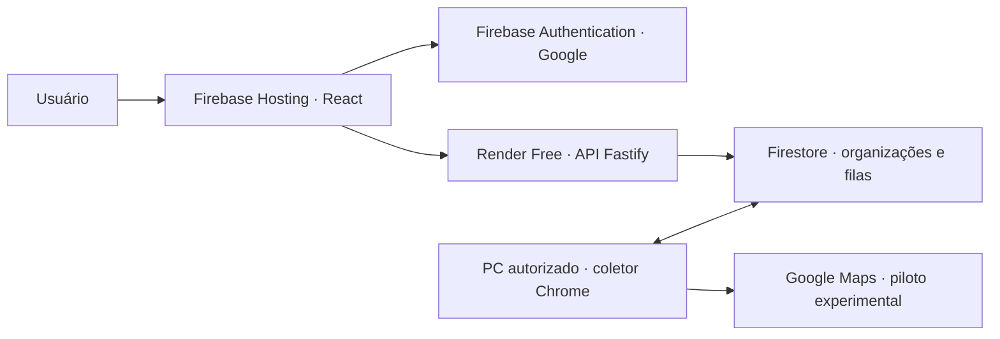

# Arquitetura atual

A API verifica o token Firebase, o e-mail, a organização, a associação ativa, o papel, a licença e o acesso à unidade. O navegador não recebe a credencial administrativa do banco. O Admin SDK ignora Security Rules: a autorização deve permanecer no servidor, e IAM deve limitar cada identidade.

A API na nuvem não executa Chrome. O coletor publica presença por organização e atende apenas sua fila. Sem presença recente, a API recusa novas auditorias. Duas instâncias concorrentes do mesmo coletor são recusadas. O encerramento marca a instância offline; interrupções abruptas expiram pelo heartbeat.

Cada auditoria reserva unidades e custos antes de criar tarefas determinísticas. Cada tarefa persiste a primeira captura antes da segunda e só confirma posição após a validação das duas. Cancelamentos mantêm histórico e liberam reservas não utilizadas. Pedidos pagos interrompidos não são repetidos cegamente: exigem reconciliação. Tarefas locais conhecidamente gratuitas podem ser encerradas sem nova coleta.

Capturas detalhadas são acessíveis apenas no escopo da unidade autorizada. O Firestore guarda as listas e seus identificadores/hashes; imagens originais do piloto ficam no computador. Não se deve apresentar um hash como armazenamento da imagem na nuvem.

Login Google é suficiente para operações comuns neste piloto. Gestão de equipe, licenças e aprovação administrativa mantêm MFA. A preferência operacional é configurada por `REQUIRE_MFA_FOR_OPERATIONAL_WRITES=false` no backend.

Firebase permanece no Spark e o Render no Free. Não há provedor pago configurado. O coletor é uma alternativa experimental dependente do PC, não uma fonte comercial licenciada.
